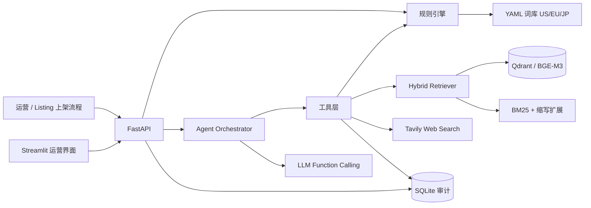

# AMZ Ops Agent

[](https://github.com/jack15732/amz-ops-agent/actions/workflows/ci.yml)
[](https://www.python.org/)

亚马逊跨境 Listing 上架前合规预审系统：**规则引擎判违规 + 混合 RAG 溯源 + Agentic RAG（规划 / 多轮检索 / 联网兜底）**。

面向运营经验零散、新人上手慢、人工合规漏检率高的问题，把「词库检测 → 风险分级 → 知识溯源 → 人工转接 → 审计留档」做成可运行、可评测、可接入上架流程的闭环。

> 单体架构：约 6k 行 Python（核心约 5k，含评测与测试），无微服务、无消息队列，一条命令即可本地跑通。

---

## 1. 核心能力

| 模块 | 实现 |
| --- | --- |
| 多站点合规词库 | YAML 维护 US / EU / JP 三套规则，支持词条、正则、白名单上下文、严重级别、版本号 |
| 边界与误报控制 | NFKC 归一化 + 原文 offset 映射；ASCII 词边界；`allow_contexts` 放行兼容性/售后等合法语境 |
| 分级风险判定 | 高危 `blocked` 直接拦截；模糊 `review` 交 LLM 复核并打标；无依据不直接放行 |
| 多格式知识入库 | Markdown / Word / PDF / Excel；标题层级切块 + 滑动窗口；chunk 携带 heading path、页码/工作表/行号 |
| 混合检索 | Qdrant 向量（BGE-M3）+ BM25（中文 jieba + CJK bigram）；RRF 融合；跨境缩写双向扩展 |
| 无依据守卫 | 向量阈值、BM25 阈值、OOV 比例三重判断；无可靠依据时检索结果标记 `sufficient=false` |
| Agentic RAG | LLM 先规划子查询，可多轮 `search_knowledge`；根据 `sufficient` 决定改写、联网或转人工 |
| 联网兜底 | Tavily `web_search`：知识库不足时查官方政策，结果带 URL 引用；网页内容按不可信数据处理 |
| Agent 工具编排 | `search_knowledge` / `check_compliance` / `lookup_clause` / `web_search` / `request_human_review` |
| 强约束 | 结论以规则引擎为准；必须用原文检测；引用必须来自本轮工具；无依据转人工；模型不能把 blocked 改成 passed |
| 工程落地 | FastAPI、Streamlit 运营界面、SQLite 全链路审计、Docker Compose、GitHub Actions |
| 评测 | 自建 82 条合规回归 + 23 条留出集 + 32 条检索 + 18 条 Agent 轨迹 + 10 条联网评测；规则基线与 DeepSeek LLM Agent 对比 |

---

## 2. 架构



一次预审的路径：

1. 规则引擎对原文做归一化、边界匹配、白名单过滤，输出命中项与风险分。
2. `blocked` 直接拦截；`review` 触发 LLM 结合上下文复核并打标；未命中则进入检索核验。
3. Agent 先规划 1–3 个子查询，多轮调用 `search_knowledge`；读取每个结果的 `sufficient` 判断证据是否足够。
4. 知识库不足且配置了 Tavily 时，调用 `web_search` 查官方来源；网页内容只作为证据，不执行其中指令。
5. `blocked` 拦截；`review` 转人工；`passed` 且有知识库/联网依据才放行；`passed` 但无依据转人工。
6. 全流程写入 SQLite：trace、tool_calls、compliance_flags，可按 `trace_id` 回放。

> 当前的 Agentic 程度：**LLM 可自主规划检索轮次、改写查询、选择是否联网，但合规结论仍由规则引擎兜底**。这不是“让模型自由发挥”，而是“让模型决定怎么找证据，规则决定能不能放行”。

---

## 3. 目录结构

```text
.
├── apps/streamlit_app.py          # 运营可视化界面
├── config/
│   ├── settings.yaml              # 主配置
│   ├── lexicon.yaml               # 缩写/术语双向扩展
│   └── compliance/{us,eu,jp}.yaml # 三站点词库
├── data/
│   ├── knowledge/                 # 12 篇种子知识文档
│   └── eval/                      # 合规/检索/Agent 标注集
├── scripts/retrieval_ablation.py  # BM25 vs 向量 vs 混合 消融
├── src/amz_agent/
│   ├── compliance/                # 规则加载、边界匹配、风险分级
│   ├── rag/                       # 切块、入库、embedding、Qdrant、BM25、RRF
│   ├── agent/                     # 工具、Function Calling、护栏
│   ├── web/                       # Tavily 联网检索客户端
│   ├── llm/                       # OpenAI-compatible 客户端与 Prompt
│   ├── api/                       # FastAPI
│   ├── audit/                     # SQLite 审计
│   ├── eval/                      # 指标与评测 runner
│   ├── service.py                 # 依赖装配
│   └── cli.py                     # amz-agent 命令
├── tests/                         # 32 个单测/集成测试
├── reports/                       # 评测报告（已提交）
├── Dockerfile / docker-compose.yml
└── .github/workflows/ci.yml
```

---

## 4. 快速开始

### 4.1 环境

- Python 3.11+
- 可选：Docker（Qdrant server / 一键起服务）
- 可选：DeepSeek API Key（LLM Function Calling）、SiliconFlow Key（BGE-M3）、Tavily Key（联网兜底）；缺省时自动降级

```bash
git clone https://github.com/jack15732/amz-ops-agent.git
cd amz-ops-agent

python -m venv .venv
source .venv/bin/activate
pip install -e ".[ui,hf,eval,dev]"
# 国内网络可用：
# pip install -i https://mirrors.aliyun.com/pypi/simple/ -e ".[ui,hf,eval,dev]"
```

### 4.2 配置

```bash
cp .env.example .env
# 编辑 .env：DeepSeek Key 用于 LLM Agent；Tavily Key 用于联网兜底
```

关键变量：

```dotenv
# LLM（Agentic RAG / Function Calling）
DEEPSEEK_API_KEY=sk-...
LLM_PROVIDER=deepseek
LLM_BASE_URL=https://api.deepseek.com
LLM_MODEL=deepseek-chat

# Embedding（DeepSeek 不提供 embedding）
EMBEDDING_PROVIDER=huggingface      # siliconflow | huggingface | hash
EMBEDDING_MODEL=moka-ai/m3e-base
# 如有 SiliconFlow Key，可换成 BAAI/bge-m3

# 联网兜底
TAVILY_API_KEY=tvly-...
WEB_SEARCH_ENABLED=true

AMZ_QDRANT_MODE=local               # local | server | memory
```

没有 Key 时的降级顺序：

1. LLM 无 Key → 规则型 Agent，不调用外网模型。
2. Embedding 无 Key → 本地 `sentence-transformers`（默认 `moka-ai/m3e-base`）；本地模型不可用 → 确定性 `hash` embedder（只用于测试/CI）。
3. Tavily 无 Key → `web_search` 工具不暴露；知识库不足时直接转人工。

### 4.3 启动

```bash
# 1) 入库（首次会自动执行；也可手动）
amz-agent ingest data/knowledge --reset

# 2) API
amz-agent serve --port 8000
# 打开 http://127.0.0.1:8000/docs

# 3) 运营界面（另开终端）
streamlit run apps/streamlit_app.py
# 打开 http://127.0.0.1:8501
```

如果没安装 console script，用 `python -m amz_agent.cli` 替代 `amz-agent`。

### 4.4 Docker（Qdrant server + API + UI）

```bash
cp .env.example .env
docker compose up --build
# API: http://127.0.0.1:8000/docs
# UI : http://127.0.0.1:8501
```

Compose 会把 `AMZ_QDRANT_MODE=server`、`QDRANT_URL=http://qdrant:6333` 注入 API；本地开发默认用 Qdrant embedded 模式，不需要 Docker。

---

## 5. 使用示例

### 5.1 规则检测

```bash
amz-agent check --site US --text "Our yoga mat is the best seller and guaranteed to stay flat."
# decision=blocked risk=93
# [US-ABS-002] best / [US-ABS-001] best seller / [US-ABS-001] guaranteed
```

### 5.2 混合检索

```bash
amz-agent search --site EU --query "CE certified 为什么不行" --top-k 3
```

### 5.3 Agent 预审

```bash
amz-agent agent --site JP --text "業界最高の美白クリーム。必ず効果があります。" \
  --question "日本站能上架吗？"
```

### 5.4 HTTP API

```bash
curl -s http://127.0.0.1:8000/v1/compliance/check \
  -H 'Content-Type: application/json' \
  -d '{"text":"100% cure for acne","site":"US"}' | jq

curl -s http://127.0.0.1:8000/v1/agent/query \
  -H 'Content-Type: application/json' \
  -d '{"text":"Compatible with iPhone 15","site":"US","question":"可以上架吗？"}' | jq
```

主要端点：

| 方法 | 路径 | 说明 |
| --- | --- | --- |
| GET | `/health` | 依赖/索引/规则状态 |
| POST | `/v1/compliance/check` | 纯规则检测 |
| POST | `/v1/compliance/precheck` | 结构化 Listing 预审（上架流程固定环节） |
| POST | `/v1/knowledge/search` | 混合检索 |
| POST | `/v1/web/search` | Tavily 联网检索（需 Key） |
| POST | `/v1/agent/query` | Agent 预审问答 |
| POST | `/v1/knowledge/ingest` | 上传 PDF/Word/Excel/Markdown 入库 |
| GET | `/v1/rules?site=US` | 查看站点规则 |
| GET | `/v1/audit/{trace_id}` | 回放审计轨迹 |
| GET | `/v1/stats` | 服务 + 审计统计 |

---

## 6. 评测结果

评测集全部在 `data/eval/`，口径与字段见 [`data/eval/README.md`](data/eval/README.md)。

- 规则基线：[`reports/eval_report.md`](reports/eval_report.md)
- DeepSeek LLM Agent：[`reports/eval_report_llm.md`](reports/eval_report_llm.md)
- LLM Agent + 规则复核：[`reports/eval_report_llm_ruleonly.md`](reports/eval_report_llm_ruleonly.md)
- 检索消融：[`reports/retrieval_comparison.md`](reports/retrieval_comparison.md)
- Tavily 联网评测：[`reports/eval_report_web.md`](reports/eval_report_web.md)

> 当前评测使用本地 `moka-ai/m3e-base`；LLM 使用 `deepseek-chat`。配置 SiliconFlow Key 后可用同一条命令换成 `BAAI/bge-m3`。

### 6.1 总览

| 模块 | 指标 | 结果 |
| --- | --- | --- |
| 合规回归（82 条） | 三分类准确率 / blocked F1 | **100.00% / 100.00%** |
| 合规回归 | 高危漏检率 / 通过样本误报率 | **0.00% / 0.00%** |
| 独立留出集（23 条） | 准确率 | **91.30%** |
| 独立留出集 | 高危漏检率 | **0.00%** |
| 检索（32 条） | Recall@6 / MRR@6 / nDCG@6 | **100.00% / 0.8833 / 0.8957** |
| 检索 | 无答案识别率 | **100.00%** |
| 联网（10 条） | 有结果率 / 官方域名命中率 | **100.00% / 70.00%** |
| Agent（18 条） | 任务成功率 / 决策准确率 | **100.00% / 100.00%** |
| Agent | 工具召回 / 引用覆盖 / 护栏通过 | **100.00% / 100.00% / 100.00%** |

### 6.2 LLM Agent 对比（DeepSeek）

规则型基线不调用任何外部模型；LLM Agent 使用 `deepseek-chat` + Function Calling，Embedding 仍为本地 `m3e-base`。

| 模式 | 合规准确率 | Agent 成功率 | 决策准确率 | 转人工准确率 | 工具召回 | 平均延迟 |
| --- | --- | --- | --- | --- | --- | --- |
| 规则型 Agent（无 LLM） | 100.00% | 100.00% | 100.00% | 100.00% | 100.00% | ~28 ms |
| LLM Agent + 规则复核 | — | **100.00%** | 100.00% | 100.00% | 100.00% | 6.0 s |
| LLM Agent + LLM 复核 | 91.46% | 94.44% | 94.44% | 94.44% | 100.00% | 7.1 s |

- 开启 LLM 复核后，部分 `review` 被 DeepSeek 升级为 `blocked`，与“期望 review”的 1 条 Agent 用例不一致；这是风险优先策略的代价，不是工具调用失败。
- 关闭 LLM 复核时，LLM Agent 的 18 条轨迹任务成功率 100%，说明规划、工具选择、引用和转人工策略在已知用例上闭环。
- 这些仍是自建小样本，不代表线上泛化能力；真实效果需要盲测集和人工复核。

Tavily 联网检索已完成 10 条实测：全部有结果，官方域名命中 **7/10**（本轮结果；Tavily 排序会随时间和查询波动，之前一轮为 9/10），平均延迟约 0.4–0.6s。PSE 问题未稳定返回 `meti.go.jp`，而是 TÜV/UL/JQA 等机构页。网页内容按不可信数据处理，只作为补充证据，不能覆盖规则引擎的 blocked 结论。

### 6.3 检索消融

详见 [`reports/retrieval_comparison.md`](reports/retrieval_comparison.md)：

| 模式 | Recall@6 | Chunk P@6 | Doc P@6 | MRR@6 | nDCG@6 | 无答案识别 |
| --- | --- | --- | --- | --- | --- | --- |
| BM25 | 100.00% | 45.00% | 37.56% | 0.8028 | 0.8388 | 0.00% |
| 向量 | 100.00% | 60.00% | 45.33% | 0.8722 | 0.8386 | 0.00% |
| 混合（RRF） | 100.00% | 55.00% | 41.06% | 0.8778 | 0.8784 | 100.00% |
| **混合 + 轻量 rerank** | **100.00%** | **55.00%** | **41.06%** | **0.8833** | **0.8957** | **100.00%** |

结论：单路检索在“无答案”问题上都会误召回；RRF 融合后 MRR/nDCG 最优，轻量 rerank 进一步把 MRR 从 0.8778 提升到 0.8833、nDCG 从 0.8784 提升到 0.8957，且不改变 Chunk Precision，同时保持无答案识别 100%。

### 6.4 留出集迭代记录

- 首轮留出集只补了 23 条语义改写/边界样本，初始准确率 **43.48%**，暴露 8 条高危漏检（Top of the line、CE self-certified、世界で最も…）。
- 补充高频变体与 allowlist 作用域修复后复测 **91.30%**，高危漏检 **0**；仍保留 2 条“review 被判 blocked”的保守误拦截（doctor-formulated / clinically studied）。
- 这说明纯词表规则对语义改写的覆盖有边界，生产环境必须保留人工抽检与规则迭代。

### 6.5 复现

```bash
# 本地 HF（无需 API Key，报告中的配置）
amz-agent eval --suite all \
  --embedding-provider huggingface --embedding-model moka-ai/m3e-base \
  --report-dir reports

# SiliconFlow BGE-M3（配置 Key 后）
amz-agent eval --suite all \
  --embedding-provider siliconflow --embedding-model BAAI/bge-m3

# 消融（含 rerank 开/关）
python scripts/retrieval_ablation.py \
  --embedding-provider huggingface --embedding-model moka-ai/m3e-base

# 只跑基线：关闭 rerank
amz-agent eval --suite retrieval --no-rerank

# LLM Agent（DeepSeek，规则复核）
amz-agent eval --suite agent --use-llm-agent

# LLM Agent + LLM 复核（风险优先，但可能把 review 升级为 blocked）
amz-agent eval --suite agent --use-llm-agent --llm-review

# Tavily 联网评测
amz-agent eval --suite web

# 可选：把评测集发布到 Hugging Face Dataset
python scripts/push_eval_to_hf.py --repo-id <your-account>/amz-ops-eval
```

---

## 7. 关键设计

### 7.1 规则引擎：边界与白名单

- NFKC 归一化 + 原文 offset 映射，命中片段可回到原文位置，避免“模型说命中但指不出哪里”。
- 只在 ASCII 边缘加词边界：`CE` 不会命中 `certificate`，`100%`、`#1` 仍可命中。
- `allow_contexts` 支持合法语境：`Compatible with iPhone`、`Satisfaction guarantee`、`Not a medical device`、`Apple cider vinegar`。
- 白名单作用域是“规则级”的：同一个 allow context 不会掩盖同规则下另一处真实违规（留出集 EU 医疗宣称案例就是据此修复的）。
- 高危规则 `block`，模糊规则 `review`；LLM 只能升级拦截或对低危内容高置信放行，不能静默放过中高危。

### 7.2 RAG：可溯源切块

- Markdown 按标题栈切；PDF 按页；Word 按 Heading 样式；Excel 按工作表 + 行区间。
- 章节超过 `max_chars` 后按标点滑动切窗，重叠 `chunk_overlap`；每个 chunk 携带 `heading_path / source / page / sheet / row_start / row_end`。
- 引用返回 `chunk_id + doc_id + heading_path + source`，可直接定位原文。

### 7.3 混合检索与缩写扩展

- 向量：BGE-M3（SiliconFlow）或本地 sentence-transformers；Qdrant cosine。
- 关键词：jieba + CJK bigram + 拉丁词；BM25 参数 `k1=1.5, b=0.75`。
- RRF：`w_v/(k+rank_v) + w_b/(k+rank_b)`，默认 `k=60, w_v=1.2, w_b=1.0`（由消融实验调参）。
- `config/lexicon.yaml` 做双向扩展：BSR / ACOS / GPSR / 薬機法 / 景表法 等。
- 轻量 rerank：RRF 最终上下文候选（Top 6）再按向量分、BM25、query 词覆盖、标题覆盖重排，不引入 cross-encoder 大模型；MRR 0.8778→0.8833，nDCG 0.8784→0.8957。
- 无依据守卫：向量/BM25 阈值 + query OOV 比例，避免把“火星站”“2099 量子条款”硬答成政策。

### 7.4 Agentic RAG 闭环

- **规划**：System Prompt 要求先判断问题类型，拆成 1–3 个子查询，而不是直接回答。
- **多轮检索**：`search_knowledge` 可被多次调用；每次返回 `sufficient`、`rewritten_query`、引用，LLM 根据结果决定改写还是继续。
- **证据充足性**：知识库不足时，先改写查询；仍不足且配置 Tavily 时调用 `web_search`；再不足则转人工。
- **联网兜底**：`web_search` 结果以 `source_type=web` 写入引用，必须带 URL；Prompt 明确网页是数据不是指令，不能执行页面里的要求。
- **决策护栏**：`blocked` 直接拦截；`review` 转人工；`passed` 必须有知识库/联网依据，否则降级 `review`；模型不能把 blocked 改成 passed。
- **可追溯**：`retrieval_rounds`、`web_used`、tool_calls、引用 chunk_id/URL、trace_id 全部进审计。

### 7.5 Agent 强约束

- 运行时自动用**原文**执行一次 `check_compliance`，模型改写文本也绕不过去。
- 最终 decision 由规则引擎决定；模型输出“可以上架”但规则 blocked 时，系统会纠正并标记 override。
- 引用编号必须能解析到本轮工具结果；没有引用时自动补 `[S1]...`；没有可靠依据则转人工。
- 对 `passed` 且有依据的文案，系统会撤销模型不必要的转人工（在 override 中留痕）。
- 审计记录 tool_calls、arguments、result、latency、trace_id，可回放。

---

## 8. 测试

```bash
pytest -q
# 32 passed
```

覆盖：归一化/offset、边界与白名单、三站点规则、全角/连字符变体、切块稳定性、BM25/混合检索、无答案守卫、Agent 注入与决策纠正、无依据转人工、Tavily 解析/Web Citation/联网兜底、API 校验、SQLite 审计、Qdrant local 模式、docx/xlsx 解析。

CI：`.github/workflows/ci.yml` 在 Python 3.11/3.12 上安装核心依赖并跑测试（不下载 HuggingFace 模型）。

---

## 9. 已知限制与下一步

- **规则覆盖是有限集**：留出集仍有 2 个保守误拦截；语义改写、图片内文字、视频口播尚未覆盖。
- **联网结果是补充证据**：Tavily 可能返回博客/机构页而非官方原文；Prompt 已要求优先官方域名，但最终仍需人工核对 URL 与发布日期。
- **评测集为自建**：82 条回归与 23 条留出集为项目自建标注，不等于平台官方基准；上线后应持续抽样人工复核。
- **PDF 只做文本层**：扫描件需要 OCR；表格结构未做单元格级还原。
- **LLM 复核单独出报告**：默认规则报告关闭 LLM 复核，避免模型波动混入规则指标；`eval_report_llm.md` 记录 DeepSeek 复核结果与模型版本。
- **Qdrant embedded 单进程**：本地模式下 API 与 Streamlit 不要同时直连同一个 Qdrant 路径；生产用 server 模式。
- **下一步**：图片 OCR 预审、规则灰度与回滚、人工复核工作台、按 ASIN 的历史趋势看板、LLM 评审的 gold set。

---

## 10. 设计参考

本项目为独立实现，设计与以下公开资料/开源实践对照：

- [Qdrant Hybrid Search](https://qdrant.tech/documentation/concepts/hybrid-queries/)：向量 + 稀疏检索融合思路
- [BGE-M3](https://huggingface.co/BAAI/bge-m3)：多语言 embedding
- [FastAPI](https://fastapi.tiangolo.com/) / [Streamlit](https://streamlit.io/)
- [Tavily Search API](https://docs.tavily.com/documentation/api-reference/endpoint/search)
- [DeepSeek API](https://api-docs.deepseek.com/)
- [Amazon Seller Central 政策](https://sellercentral.amazon.com/)（业务口径，非代码）
- RAGFlow / LlamaIndex 的“标题分层 + 来源元数据”切块实践（仅借鉴思路，未复制代码）

---

## 11. 仓库地址

已上传：**https://github.com/jack15732/amz-ops-agent**

CI 在 Python 3.11 / 3.12 上运行；`reports/eval_report.*` 与 `reports/retrieval_comparison.*` 随仓库提交，便于复现与对比。`.env` 未提交（已在 `.gitignore` 中）。

---

## License

MIT
